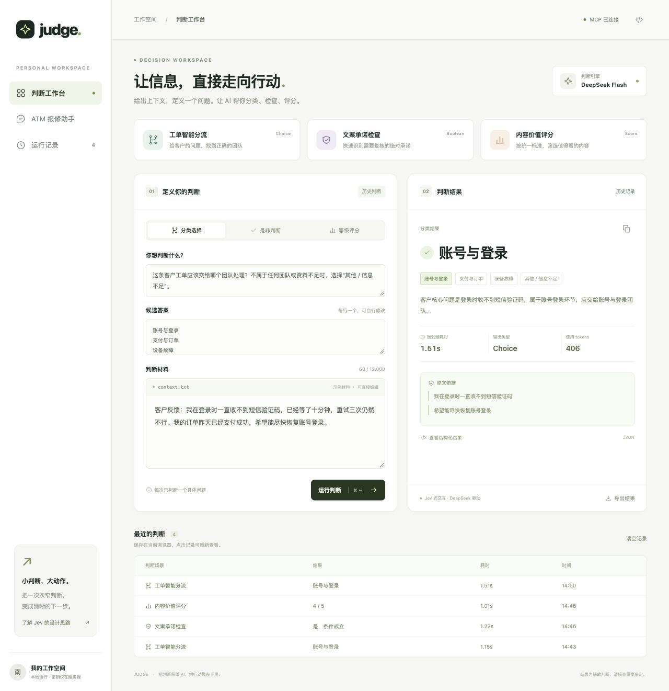
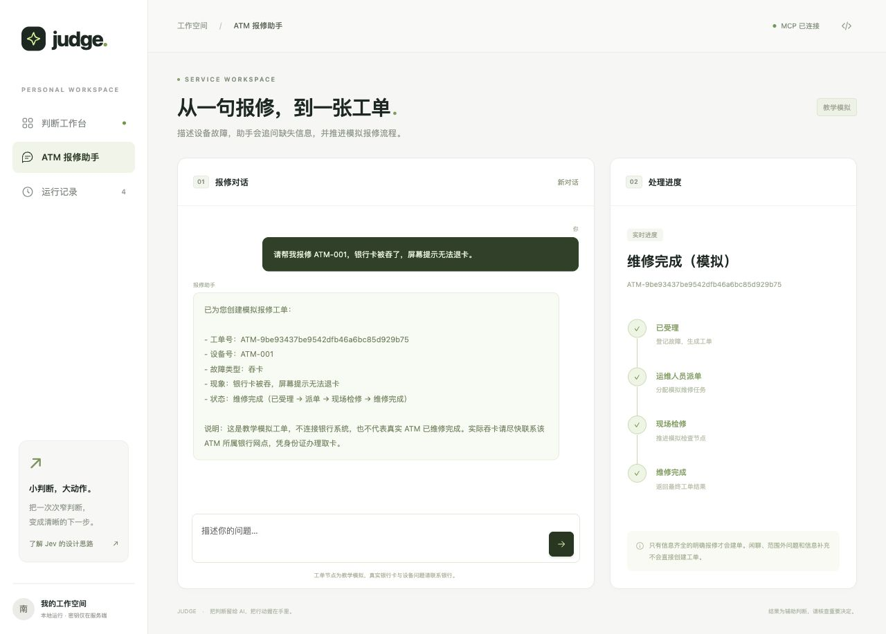
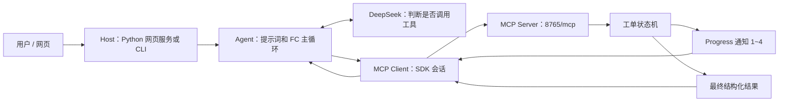

# JUDGE · 快速判断工作台 + ATM MCP 课程实践

可运行的本地项目：漂亮的判断工作台、真实 DeepSeek 推理、MCP Streamable HTTP 工具与实时进度，以及满足课程要求的 ATM 报修助手。

主页面借鉴 Jev 的“给定材料 → 明确问题 → 类型化判断”交互，支持 **Choice 分类、Boolean 条件检查、Score 1~5 等级评分**。实际推理由 DeepSeek 完成；没有重现 Jev 的模型架构、RLCD 训练或概率校准，也不承诺 Jev 的响应速度。页面耗时来自本次实际调用，未生成伪置信度。



项目以 MIT 许可证公开。更详细的设计见 [架构文档](docs/ARCHITECTURE.md)，运行证据与限制见 [验收记录](docs/VERIFICATION.md)。

## 下载项目

```bash
git clone https://github.com/147228/judge-mcp-workbench.git
cd judge-mcp-workbench
```

也可以在 GitHub 点击 **Code → Download ZIP**，解压后进入包含 `requirements.txt` 的目录。本地交付包包含相同源代码及截图、运行日志；不包含虚拟环境和个人密钥。

## 一条命令打开前端

在本项目目录中执行。需要 Python 3.10+，推荐 3.13；本次实测环境为 macOS / Python 3.12。

Windows / Conda / PowerShell：

```powershell
conda create -n judge-mcp python=3.13 -y
conda activate judge-mcp
python -m pip install -r requirements.txt
if (!(Test-Path .env)) { Copy-Item .env.example .env }
notepad .env
python scripts/start_app.py
```

在 `.env` 填写自己的 `DEEPSEEK_API_KEY`，保留默认 URL 与模型名；若已有本地配置，不要覆盖。

macOS / Linux：

```bash
python3 -m venv .venv
source .venv/bin/activate
python -m pip install -r requirements.txt
[ -f .env ] || cp .env.example .env
# 用本地编辑器填写 .env 中的 DEEPSEEK_API_KEY
python scripts/start_app.py
```

浏览器打开 **http://127.0.0.1:8800**。启动器运行两个独立进程：MCP 在 8765，网页在 8800；Ctrl+C 只停止本次创建的进程。如果端口已占用，启动器会退出，不会终止别人的进程。也可以把网页端口改为 `python scripts/start_app.py --port 8801`。

没有模型密钥时仍可启动 MCP 并运行下面的直调烟测；网页判断与报修对话需要配置模型。

## 模型配置

| 配置项 | 默认值 / 说明 |
| --- | --- |
| `DEEPSEEK_API_KEY` | 在本地 `.env` 填写；不要提交 Git 或粘贴到网页 |
| `LLM_BASE_URL` | `https://api.deepseek.com`；可替换为兼容服务地址 |
| `LLM_MODEL` | `deepseek-flash`；根据自己账号可用模型修改 |
| `LLM_API_KEY` | 使用其它兼容服务时填写，优先级高于 DeepSeek / OpenAI 专用变量 |
| `MCP_URL` | `http://127.0.0.1:8765/mcp` |
| `LLM_TIMEOUT` | `60` 秒 |

常规安装使用 `requirements.txt`；`requirements-lock.txt` 记录本次 macOS / Python 3.12 的完整依赖版本，包含测试依赖。跨平台优先按常规依赖安装；如需复现本次依赖组合，可使用 `python -m pip install -r requirements-lock.txt`。

## 网页里能做什么

| 入口 | 真实功能 | 如何演示 |
| --- | --- | --- |
| 工单智能分流 | 从自定义候选里选择客户问题所属团队 | 默认示例同时提到支付和登录，应按主要诉求分到“账号与登录” |
| 文案承诺检查 | 检查材料是否满足指定条件 | 默认文案含“保证”“100%”，应返回条件成立及原文依据 |
| 内容价值评分 | 按明确标准输出 1~5 整数等级 | 可以修改评分标准和待评文本 |
| ATM 报修助手 | 多轮追问、自动 Function Calling、MCP 四节点 | 点击侧栏，输入设备号与吞卡现象 |
| 运行记录 | 在当前浏览器保存最近 12 次判断 | 点击恢复材料与结果，或清空记录 |
| JSON / 导出 / 调用过程 | 查看真实结构化结果、复制或下载 JSON、查看工具通知 | 点击右上角代码图标显示调用过程 |

手机窄屏时，可用顶部“报修助手 / 快速判断”按钮切换。页面支持 Ctrl+Enter / Cmd+Enter，中文输入法组合输入不会误发送。



手机效果：[评分页面](output/playwright/mobile-score.jpg)、[报修页面](output/playwright/mobile-repair.jpg)。内置浏览器如果无法触发 JSON 下载，可展开结构化结果手动复制，或用 Chrome / Edge 打开本地地址。

判断工具只读，不执行退款、真实派单或其它动作。证据引文必须来自原文；不匹配的引文会被移除并触发复核提示。类型正确不代表结论正确，重要判断需要人工核查。

## 原课程要求：不经 LLM 的直调

终端一：

```bash
python scripts/mcp_server.py --debug
```

默认地址为 **http://127.0.0.1:8765/mcp**，工具包括 `atm_repair` 和扩展的 `quick_judge`。

终端二：

```bash
python scripts/mcp_direct_demo.py --debug
```

直调脚本不读取模型密钥，也不访问模型。SDK 自动发现工具，再通过 `call_tool(progress_callback=...)` 接收四节点：

```text
[进度 1/4] ATM-<唯一编号> | 已受理（模拟）
[进度 2/4] ATM-<唯一编号> | 运维人员派单（模拟）
[进度 3/4] ATM-<唯一编号> | 现场检修（模拟）
[进度 4/4] ATM-<唯一编号> | 维修完成（模拟）
PASS | ticket_id=ATM-<唯一编号> | status=维修完成 | 四节点进度齐全
```

其它故障：

```bash
python scripts/mcp_direct_demo.py --atm-id ATM-003 --fault-type 不出钞 --describe "取款后没有现金吐出" --debug
python scripts/mcp_direct_demo.py --atm-id ATM-004 --fault-type 系统故障 --describe "屏幕死机，无法继续操作" --debug
```

`--step-delay` 可调整服务端节点间隔；重启前请先停止本项目服务。工单保存在服务端内存，重启后消失；四节点均为教学模拟。

## 原课程要求：LLM 自动调用 MCP

服务端运行时：

```bash
python scripts/llm_client.py --debug
```

试这几句：

```text
你好，今天心情不错。
请帮我报修 ATM-001，银行卡被吞了，屏幕提示无法退卡。
我的手机黑屏了，请帮我修手机。
```

也支持一次性调用：

```bash
python scripts/llm_client.py --message "请帮我报修 ATM-001，银行卡被吞了。" --debug
```

缺设备号时会追问，前文已给出的故障现象可供下一轮使用。`/reset` 清空对话，`/quit` 退出。

其它 OpenAI 兼容云端接口只需设置 `LLM_BASE_URL`、`LLM_MODEL`、`LLM_API_KEY`。模型须支持 Chat Completions 的工具调用；快速判断还需要 JSON Object 模式。密钥全部由 Python 读取，浏览器不会收到密钥，`.env` 已排除 Git 与交付压缩包。

## MCP、Client、Host 和 Agent 的关系



`list_tools → OpenAI tools → tool_calls → MCP call_tool + progress → role=tool → 最终回复`。

Host 是组织模型、会话和工具的应用；Agent 是其中的决策循环；MCP Client 负责协议连接与调用；Server 负责暴露工具并执行业务。工具不会由模型自身执行。

快速判断入口采用直调链路：网页 → Python Client → MCP `quick_judge` → 服务端调用 DeepSeek → 类型校验 / 引文校验 → 返回结果。ATM 入口则采用上图的 LLM 自动 Function Calling 链路。

## 验收与代码入口

```bash
python -m pip install -r requirements-dev.txt
python -m pytest -q
python scripts/llm_acceptance.py --debug
```

`pytest` 使用模拟模型响应，不产生云端费用；`llm_acceptance.py` 使用真实云端 API，会消耗 token。直调不需要模型或联网，但首次安装依赖需要联网。

| 文件 | 用途 |
| --- | --- |
| `atm_mcp/server.py` | MCP 工具注册与 Streamable HTTP 服务 |
| `atm_mcp/domain.py` | 参数校验、唯一工单号、内存状态机 |
| `atm_mcp/transport.py` | MCP 会话、进度回调与资源关闭 |
| `atm_mcp/bridge.py` | schema 转换、参数校验、远程调用 |
| `atm_mcp/agent.py` / `prompts.py` | FC 循环、职责边界、追问策略 |
| `atm_mcp/judge.py` | 三类结构化判断与证据验证 |
| `atm_mcp/web.py` / `web/` | 网页 API、事件流与响应式前端 |
| `artifacts/` | 本次实际运行日志与验收 JSON |
| `output/playwright/` | 浏览器演示截图 |

固定 MCP SDK **1.30.0**，使用对应版本的 FastMCP / ClientSession API，避免 SDK 2.x 的接口变化影响复现。本机已验证；未在 Windows 真机执行，Windows 命令按 Conda / PowerShell 提供。

## 课程要求对照

| 课程要求 | 实现 / 演示入口 |
| --- | --- |
| Server 暴露工具、Client 发现并调用 | `server.py` 注册工具；`transport.py` / `bridge.py` 连接与 `list_tools` |
| Streamable HTTP，默认 8765/mcp | `scripts/mcp_server.py` |
| 吞卡、不出钞、系统故障，唯一工单号 | `domain.py` 参数校验与 UUID 工单 |
| 四节点实时 progress 通知 | `mcp_direct_demo.py` 回调打印；网页节点列表 |
| MCP schema → OpenAI tools → FC 主循环 | `bridge.py` / `agent.py`，使用 `role=tool` 和对应调用 ID 回填 |
| 闲聊不建单、缺号追问、范围外不调用 | `prompts.py` 与真实云端验收脚本 |
| `--debug` 查看 tool_calls 与 MCP 原始结果 | CLI `--debug`；网页“查看调用过程” |
| 实际问题扩展 | 客服工单分流、文案承诺检查、内容等级评分 |

## 常见问题

- **端口占用**：先确认自己的旧服务是否仍在运行。不要直接结束不认识的进程；网页可换端口，MCP 如需换端口可分终端启动并同步修改 `MCP_URL`。
- **MCP 未连接**：确认服务端运行，路径为 `/mcp`，客户端与服务端端口一致。`/api/health` 会实际连接并列出工具。
- **缺少密钥 / 401**：检查项目目录的 `.env`、密钥是否有效，以及请求的服务是否匹配。修改环境配置后重启本项目服务。
- **429 / 余额不足 / 超时**：按云端返回信息处理额度或网络问题。报修已有进度但结果未确认时，不要直接重复建单。
- **判断结果需复核**：模型会犯错；类型与引文校验只验证输出形式、引用来源，不能证明分类或评分正确。
- **聊天已有工单，后续闲聊仍显示节点**：进度面板保留最近一张工单；点击“新对话”会清空当前界面并启用新的会话 ID。

源码、测试、文档、演示截图都在仓库中；`artifacts/` 是一次实际验收的快照，不是准确率或性能基准。模型请求会消耗自己账号的 token。示例材料为演示文本，不含真实客户信息。

## 参考资料

- [MCP Python SDK 1.30.0](https://github.com/modelcontextprotocol/python-sdk/tree/v1.30.0)
- [OpenAI Function Calling 官方文档](https://developers.openai.com/api/docs/guides/function-calling)
- [DeepSeek Tool Calls 官方文档](https://api-docs.deepseek.com/guides/tool_calls/)
- [Jev / System One 官方介绍](https://typesafe.ai/blog/introducing-system-one-models-and-jev)
- [TypeSafe Choice](https://docs.typesafe.ai/primitives/choice)、[Score](https://docs.typesafe.ai/primitives/score)、[Noul](https://docs.typesafe.ai/primitives/noul)

## 维护者与个人网站

本仓库维护者：[丸美小沐（GitHub @147228）](https://github.com/147228)。

- [个人网站：丸美小沐的博客](https://147227.xyz/)
- [关于维护者](https://147227.xyz/about/)
- [项目与作品总览](https://147227.xyz/projects/)
