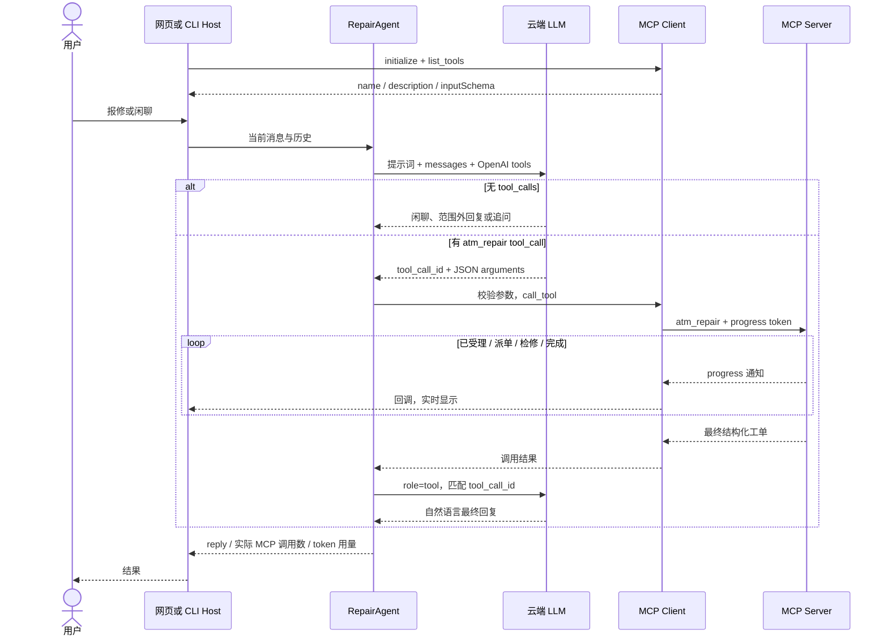
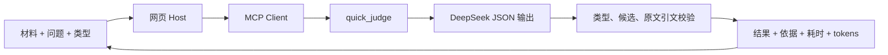

# 架构与接口

本项目保留课程要求的 ATM 自动报修链路，同时增加面向日常窄判断的工作台。两种入口共享 MCP SDK 和进度机制，使用不同的调用路径。

## 1. 进程与职责

| 部分 | 地址 / 文件 | 职责 |
| --- | --- | --- |
| 浏览器 | `http://127.0.0.1:8800/`，`web/` | 编辑材料，显示结果、依据、耗时、运行记录与工单进度 |
| Host / 网页后端 | `atm_mcp/web.py` | 组织会话，读取配置，创建 MCP Client，转发 SSE 事件 |
| Agent | `atm_mcp/agent.py`、`prompts.py` | ATM 职责约束、追问、Function Calling 循环 |
| MCP Client | `transport.py`、`bridge.py` | 初始化连接、发现 schema、调用工具、处理 progress |
| MCP Server | `http://127.0.0.1:8765/mcp`，`server.py` | 暴露 `atm_repair`、`quick_judge` 并执行业务 |
| 业务层 | `domain.py`、`judge.py` | 工单状态推进；模型判断、类型校验、引用校验 |
| 云端模型 | `.env` 中的兼容 API | ATM 工具选择与自然语言回复；结构化判断推理 |

`scripts/start_app.py` 创建两个子进程。它先检查端口，并只回收自己创建的进程。前端无构建步骤，不依赖 Node、CDN 字体或外部图片。

## 2. ATM：LLM 自动调用远程工具



适配层只向 ATM Agent 提供 `atm_repair`。工具 schema 来自 MCP 发现结果，增加禁止额外字段的约束，并在调用前验证 JSON。未知工具、非法 JSON 与缺失字段会返回工具错误，不触发业务执行。

每轮最多执行四轮工具请求，之后要求模型直接答复。同一用户轮次内，相同参数的重复调用复用结果，防止模型重复创建工单；不同轮次和不同客户端没有全局幂等保证。副作用调用失败后不会自动重试。

### 工单参数与状态

```json
{
  "atm_id": "ATM-001",
  "fault_type": "吞卡",
  "describe": "银行卡被吞，屏幕提示无法退卡"
}
```

`fault_type` 只允许 `吞卡`、`不出钞`、`系统故障`。设备号、描述必须非空且符合长度限制。服务端生成 `ATM-<UUID>` 工单号，按顺序记录 `已受理 → 运维人员派单 → 现场检修 → 维修完成`，最终返回 `ticket_id`、`status`、`history` 和 `simulation: true`。

状态属于 Server 内存；progress 是执行过程的通知，不能代替最终业务结果。中断不会被当成成功，状态会记录为中断；服务器重启后工单消失。这些节点没有接入真实银行或维修人员。

## 3. 快速判断：Client 直调 MCP，由工具内部推理



这是借鉴 Jev 的类型化判断交互，实际模型为 DeepSeek，没有调用 TypeSafe 的 Jev API。工具接受：

```json
{
  "state": "客户一直收不到登录验证码，订单已支付成功。",
  "question": "按当前主要诉求分给哪个团队？",
  "kind": "choice",
  "options": ["账号与登录", "支付与订单", "其他 / 信息不足"]
}
```

| 字段 | 约束 |
| --- | --- |
| `state` | 必填，最多 12,000 字符 |
| `question` | 必填，最多 1,500 字符；应包含明确的判断条件或评分标准 |
| `kind` | `choice` / `boolean` / `score` |
| `options` | Choice 需要 2~12 个唯一非空候选；其它模式可省略 |

结构化结果包括 `decision`、`model`、`inference_ms`、`total_tokens`。其中：

- Choice 必须返回候选之一；建议为资料不足准备专门候选。Boolean 必须返回布尔值，Score 必须返回 1~5 的整数；这两类在无法确定时可返回空值并要求复核。
- `reason` 是简短理由，`evidence` 最多三段。每段必须是原材料的连续引文；不匹配的内容会移除并设置 `needs_review`。
- 只允许当前模式对应的字段有值。`probability` 始终为空，因为本项目没有校准过的概率模型。
- 网页额外显示 `end_to_end_ms`：从后端进入调用到收到 MCP 最终结果，包含本地连接与云端推理，不包含浏览器渲染耗时。`inference_ms` 只记录模型请求段。
- 判断 progress 为 `接收输入 → 模型分析 → 返回类型与引文校验 → 判断完成`，不表示模型内部计算的百分比。

## 4. 网页接口与事件流

| 接口 | 方法 | 返回 |
| --- | --- | --- |
| `/api/health` | GET | MCP 连接状态、配置状态、模型名、发现的工具名 |
| `/api/judge` | POST | 接受上述判断参数；SSE `start` / `progress` / `result` / `error` |
| `/api/chat` | POST | `message`、`session_id`、可选 `debug`；SSE `debug` / `progress` / `result` / `error` |

两类 POST 都用 JSON。HTTP 成功只代表事件流已建立；客户端必须收到 `result` 才确认完成。长请求每十秒发送保活注释。断开网页请求会取消其对应任务；最终结果未确认时界面提示不要重复报修。

聊天会话最多 100 个，空闲超过 30 分钟后在访问时失效；每个会话有锁。浏览器使用随机会话 ID，点击“新对话”生成新 ID。快速判断记录只存当前浏览器的 localStorage，最多保留 12 次；不是服务端数据库。

## 5. 配置、数据与边界

`.env` 由 Python 读取。网页不会收到密钥；调试输出会替换已知密钥和常见密钥格式。公开源代码和交付 ZIP 都排除 `.env`、虚拟环境、缓存与运行 PID 文件。

默认服务仅绑定本机回环地址。模型推理会把用户填写的材料发送给其配置的云端 API；公开仓库中的演示材料均为测试文本。此版本用于本地学习和演示，尚未增加公开部署所需的用户鉴权、持久化工单、跨请求幂等和审计系统。

模型能够返回符合类型的结果，不等于结果正确。原文引文真实也不证明推理成立；分类、评分与条件检查应在自己的标注数据上另行评估。
